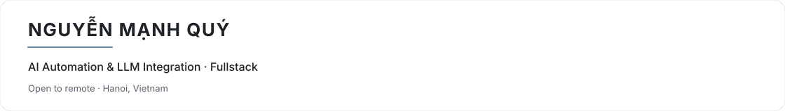
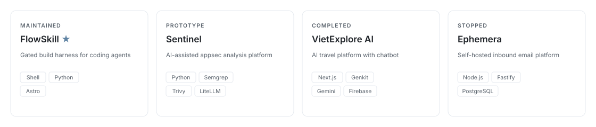
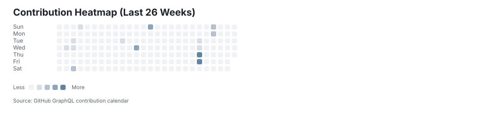

# Nguyen Manh Quy

<picture>
  <source media="(prefers-color-scheme: dark)" srcset="./assets/readme/banner-dark.svg">
  <source media="(prefers-color-scheme: light)" srcset="./assets/readme/banner-light.svg">
  
</picture>

AI Automation & LLM Integration · Fullstack · Open to remote work

## About

- Completed Vingroup–VinUni AI20K (cohort 2); IT engineer from VIU (graduated Dec 2025).
- Creator and maintainer of FlowSkill, an open-source gated build harness for coding agents; programming instructor at Teky for 100+ students since 2023.
- Focused on AI automation, LLM integration, and fullstack development; open to remote roles.

## Selected Work

<picture>
  <source media="(prefers-color-scheme: dark)" srcset="./assets/readme/work-dark.svg">
  <source media="(prefers-color-scheme: light)" srcset="./assets/readme/work-light.svg">
  
</picture>

- **[FlowSkill](https://flowskill.io.vn)** — Maintained · Gated build harness for coding agents ([GitHub](https://github.com/manhquydev/flow-skill) · [npm](https://www.npmjs.com/package/@manhquy/flow-skill))
- **[Sentinel](https://github.com/manhquydev/sentinel-security-platform)** — Prototype · AI-assisted appsec analysis platform
- **[VietExplore AI](https://viet-explore-ai.vercel.app)** — Completed · AI travel platform with chatbot ([GitHub](https://github.com/manhquydev/VietExplore-AI))
- **[Ephemera](https://github.com/manhquydev/email-platform)** — Stopped · Self-hosted inbound email platform

## Stack

| Category | Technologies |
|---|---|
| **AI/LLM** | Gemini · Genkit · LiteLLM · Claude Code · Structured outputs |
| **Languages** | TypeScript · Python · JavaScript |
| **Frameworks** | Next.js · FastAPI · Node.js · React |
| **Data & Infra** | PostgreSQL · Firebase · MongoDB · Redis · Docker · REST API |

## Activity

<!-- CONTRIBUTION-GRAPH:START -->

  <picture>
    <source media="(prefers-color-scheme: dark)" srcset="./assets/readme/contribution-heatmap-dark.svg">
    <source media="(prefers-color-scheme: light)" srcset="./assets/readme/contribution-heatmap-light.svg">
    
  </picture>

<!-- CONTRIBUTION-GRAPH:END -->

## Connect

[GitHub](https://github.com/manhquydev) · [LinkedIn](https://linkedin.com/in/manhquy) · [Email](mailto:hello@manhquy.id.vn) · [Website](https://www.manhquy.id.vn)

Hanoi, Vietnam · Open to remote work

---

Auto-updated daily via GitHub Actions.
